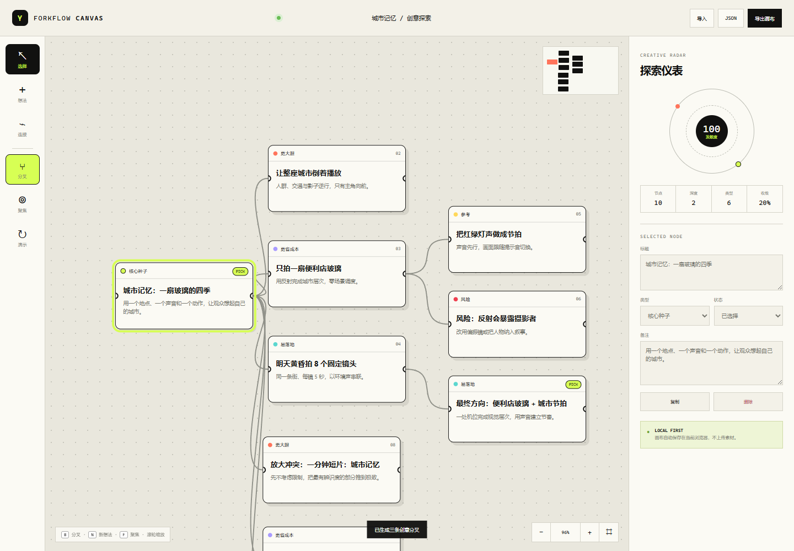

# Forkflow Canvas｜创意分叉画布

Forkflow Canvas 是一个本地优先的无限画布，把一个模糊想法一键分叉成三条可比较路径：**更大胆、更省成本、更易落地**。你可以拖拽节点、建立关系、聚焦某条思路、标记最终选择，并导出 JSON 项目或 PNG 画布。



## 为什么做它

截至 2026-11-06，开源白板 [Excalidraw](https://github.com/excalidraw/excalidraw) 约有 135,000 Stars、16,000 Forks，[tldraw](https://github.com/tldraw/tldraw) 约有 51,000 Stars、3,600 Forks。无限画布已经证明非常适合视觉思考；tldraw 社区还展示了[语音代理直接操作白板](https://www.youtube.com/watch?v=U9Ip6bScXcM)和把画布用于并行创意探索的工作流。

Forkflow Canvas 没有复制它们的代码。它把无限画布收窄到一个具体问题：**当创作者只有一个初始想法时，怎样快速产生差异明显、成本不同、落地速度不同的替代方案？**

## 核心功能

- 三向分叉：选中节点后按 `B`，自动生成大胆、省成本、易落地三条路径；
- 无限画布：拖动画布、拖拽节点、鼠标滚轮缩放、自动适应内容；
- 路径聚焦：只突出选中节点的祖先与后代，暂时淡化旁支；
- 创意雷达：统计节点数量、探索深度、类型多样性、发散度和收敛度；
- 状态标记：探索中、已选择、暂存；
- 自由连接：使用连接工具建立非树状关系；
- 本地自动保存：数据只保存在浏览器 `localStorage`；
- 导入导出：JSON 可继续编辑，PNG 可用于汇报和沟通；
- 快捷键：`V` 选择、`N` 新节点、`C` 连接、`B` 分叉、`F` 聚焦、`0` 适应画布。

## 运行

需要 Node.js 20 或更新版本。

```bash
npm install
npm start
```

打开 `http://127.0.0.1:4175`。

## 测试

```bash
npm test
npm run test:ui
npm run check
```

真实界面测试使用本机 Edge，覆盖三向分叉、聚焦、检查器编辑、拖拽、JSON/PNG 下载、桌面与移动端布局，并检查控制台错误。

## 隐私与成本

- 纯 HTML / CSS / JavaScript；
- 无运行时第三方依赖；
- 无账户、无服务器、无 API Key；
- 不上传画布内容；
- 不需要付费服务。

## License

[MIT](LICENSE)
